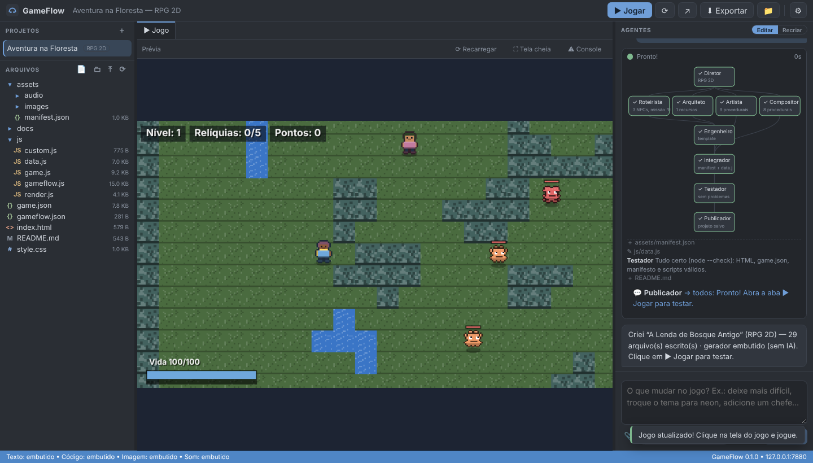
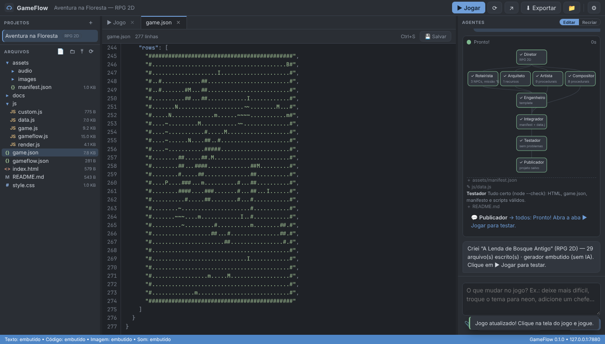
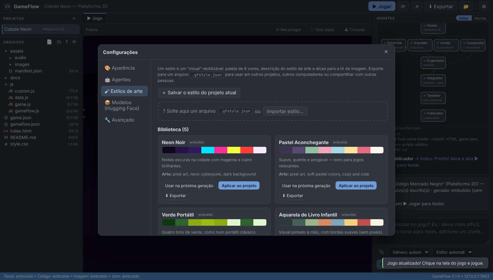
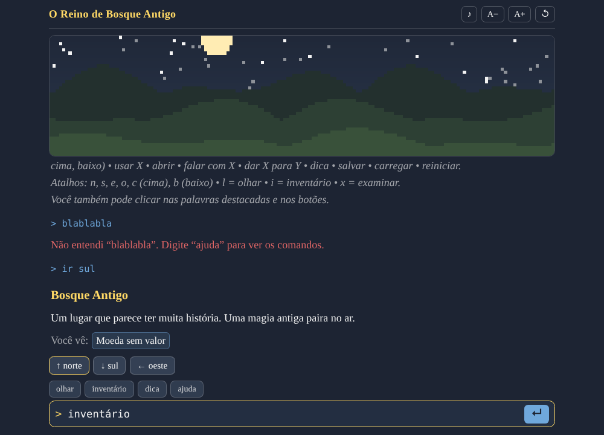
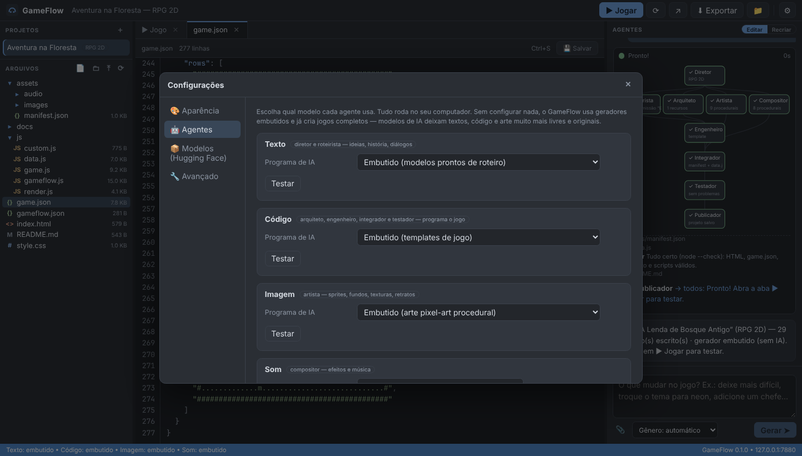

<div align="center">

# 🎮 GameFlow

**A VS Code / Cursor-style low/no-code IDE that builds complete games from text — with generative AI running 100% on your own computer.**

Rust backend · HTML, CSS and JS for the interface and for the generated games · Windows, macOS and Linux

**English** · [Português (Brasil)](README.pt-BR.md)



</div>

---

> The interface is currently in Brazilian Portuguese. Generated games speak the language of your prompt (Portuguese or English).

## What it is

You describe a game ("a 2D RPG in an enchanted forest with a dragon as the final boss"), optionally attach drawings or sounds, and a **non-linear flow of local AI agents** — Director, Writer, Architect, Artist, Composer, Engineer, Integrator, Tester and Publisher — builds the whole thing: code, maps, story, art and sound. The result is a project made of plain **HTML, CSS and JS** that runs in any browser with nothing to install.

Built for **non-programmers, indie artists and enthusiasts**:

- **Right side**: the prompt bar + the agent flow working in real time.
- **Left side**: projects and files (code, images, sounds) — everything is editable.
- **Center**: the live game, or the code editor.

It works **with no AI model configured at all** (built-in generators already deliver complete, playable games) and gets much freer and more original when you plug in local Hugging Face models.

## Install (from the terminal)

**Linux and macOS**

```bash
curl -fsSL https://raw.githubusercontent.com/KMC1525/GameFlow/main/install.sh | sh
```

**Windows (PowerShell)**

```powershell
irm https://raw.githubusercontent.com/KMC1525/GameFlow/main/install.ps1 | iex
```

**From source** (any system with [Rust](https://rustup.rs))

```bash
cargo install --git https://github.com/KMC1525/GameFlow --locked
```

Then just run:

```bash
gameflow
```

GameFlow opens the interface in your browser (`http://127.0.0.1:7878`).

### Updating

```bash
gameflow update          # downloads and installs the latest release (SHA-256 verified)
gameflow update --check  # only checks whether a new version exists
```

### Commands

| Command | What it does |
|---|---|
| `gameflow` / `gameflow start [--port N] [--no-open]` | Starts the IDE |
| `gameflow generate "description" [--name X] [--genre G] [--preset P] [--attach file]` | Generates a game from the terminal, without opening the UI |
| `gameflow preset list \| import FILE \| export ID [--out FILE] \| delete ID` | Manages [style presets](#style-presets) |
| `gameflow doctor` | Shows folders, detected AI runtimes and configured agents |
| `gameflow paths` | Shows where projects, models and settings live |

### Environment variables (optional)

| Variable | Purpose |
|---|---|
| `GAMEFLOW_HOME` | Keeps **everything** (projects, models, presets, settings) in a single folder — handy for portable installs |
| `GAMEFLOW_HF_ENDPOINT` | Uses another address instead of `https://huggingface.co` (mirrors/proxies) |

## Getting started

1. **＋ New project** — every game is saved in its own project with all its code and assets.
2. **Describe the game** in the bar on the right and click **Generate ➤**. Watch each agent work.
3. **▶ Play** — test right away. Ask for changes in plain language ("make it harder", "neon theme", "add double jump") or edit the files on the left — the preview reloads when you save (`Ctrl+S`).
4. **⬇ Export** — downloads the game as a `.zip`. Just open `index.html` in any browser (or publish it on itch.io).



### Attaching references and assets 📎

Drag or attach images/sounds to the prompt bar. Each attachment can be:

- **reference** — inspiration for the AI; the colors of your images become the **game palette**;
- **use in game** — the file goes into the game as-is. GameFlow matches by file name (`hero.png` → player, `boss.png` → boss, `music.wav` → soundtrack, `background.png` → scenery…). Your files are **never** overwritten by the agents.

You can combine both: text + attachments.

## Style presets

A **style preset** is a reusable "look": an 8-color palette, an art-style description and hints for the image model. Use them to give several games the same visual identity, share a look with other people, or keep your favorite styles around.

- **Pick one** in the prompt bar (`Style:` selector) for the next generation, or **apply it to an existing project** — the palette, `style.css` and all generated art are redone (your own files stay untouched).
- **Export** any preset to a portable `.gfstyle.json` file; **import** files from other people or computers (drag them onto Settings → *Estilos de arte* or onto the prompt bar).
- **Save the style of a project** to your library to reuse it elsewhere.
- Five presets ship with GameFlow: *Neon Noir*, *Cozy Pastel*, *Handheld Green*, *Storybook Watercolor* and *Ember Dusk*.
- From the terminal: `gameflow preset export neon-noir`, `gameflow preset import look.gfstyle.json`, `gameflow generate "…" --preset neon-noir`.

Imported files are validated (format, version, size, `#rrggbb` colors) and are always stored under a fresh id, so they can never overwrite a built-in preset. The file format is documented in [`docs/STYLE_PRESETS.md`](docs/STYLE_PRESETS.md).



## Game types

| Genre | Style | Highlights |
|---|---|---|
| **2D RPG** | top-down | exploration, NPC dialogue, real-time combat, XP/levels, relics that wake the boss |
| **3D RPG** | elevated third-person camera (Q/E rotate) | same logic as the 2D RPG in a 3D world |
| **Visual Novel** | scenes + portraits | branching script, choices with variables, multiple endings |
| **2D Platformer** | side-scrolling | editable text-based levels, variable jump, coins, enemies, spikes, optional double jump |
| **3D Platformer** | third-person camera | platform course, checkpoints, patrolling enemies |
| **FPS** | raycasting | mazes, ammo, health, minimap |
| **TPS** | 3D arena | enemy waves, shooting, health drops |
| **Arcade** | spaceship | waves, power-ups, shield, final boss |
| **Text adventure** | web terminal | rooms, items, characters and a solvable puzzle; typed commands (English or Portuguese) or clickable words and exits; hints, save/continue |

The genre is detected from your text (or picked in the selector). Maps and levels are procedurally generated (deterministic) and stored as **plain text** in `game.json`, so anyone can edit them by hand.

### Text adventures

Ask for one with words like *"a text adventure in a haunted castle"* (or pick **Aventura de Texto** in the genre selector). You get a classic interactive-fiction game that runs in the browser — no canvas, just text:



- **Playable two ways**: type commands (`look`, `go north`, `take key`, `talk to…`, `give X to Y`, `use`, `open`, `read`, `inventory`, `hint`, `save`, `restart` — Portuguese verbs work too) **or** click the highlighted items, people and exits. Type `help` for the list; ↑/↓ browse the command history.
- **Always winnable**: the generator builds a connected map with one puzzle chain (find a gift → trade it with a keeper for the key → open the locked chamber → bring the relic home) and a **walkthrough** that the automated tests replay in the real game engine. The Tester agent re-validates the world every time — including AI- and hand-edited ones — and reports unreachable rooms, dangling references or an impossible goal.
- **Everything is data** in `game.json → world`: rooms, exits, locks, items, people, hints, intro and ending. Edit the text freely; the author's solution lives in `docs/walkthrough.md` (spoilers — delete `world.walkthrough` from `game.json` if you do not want to ship it).
- **With a text model**, the Writer rewrites room names/descriptions, item/people descriptions, the intro and the ending with more atmosphere. It can never break the map or the puzzle (structure, item/people names, the key trade and the clue note are protected).
- Each room gets an illustration (procedural pixel art, your own images, or an image model) and the game has a soundtrack and effects. Ask for *"a new map"* to roll another adventure; difficulty changes the map size.
- Extend it in `js/custom.js` with `GF.on('command' | 'enter' | 'event' | 'start', …)` — for example your own secret commands.

## The agents: a non-linear flow

```
              ┌─► Writer ─────┐
   Director ──┼─► Architect ──┴─► Engineer ─┐
              ├─► Artist ───────────────────┼─► Integrator ─► Tester ─► Publisher
              └─► Composer ─────────────────┘       │            │
                       ▲   requests for missing assets ◄┘        │
                       └──────── rework (Engineer #2…) ◄─────────┘
```

- Nodes run **in parallel** as soon as their dependencies finish and talk through a shared blackboard.
- The **Integrator** notices missing assets and **asks the Artist/Composer** for them (new nodes are born at run time).
- The **Tester** validates HTML, `game.json`, the script, the asset manifest and the syntax of every script (with `node --check` if Node.js is installed). If it finds problems it **sends the game back to the Engineer** with the list (up to N rounds); if the error persists, the problematic code is isolated and restored so the base game stays playable.
- Each agent uses the model of its **task** (text, code, image or sound) — and **always** has a built-in fallback, so the pipeline never stalls for lack of a model.

| Agent | Task | What it does |
|---|---|---|
| Director | text | Turns the request (plus reference colors or the chosen style) into the game design |
| Writer | text | Dialogue, quest, characters and Visual Novel scripts |
| Architect | code | Picks template features and generates maps/levels |
| Artist | image | Sprites, tiles, backgrounds, textures and portraits (uses your files when marked) |
| Composer | sound | Sound effects and soundtrack |
| Engineer | code | Instantiates the template and writes extra mechanics in `js/custom.js` |
| Integrator | code | Asset manifest, `index.html`, `js/data.js` |
| Tester | code | Validates and requests fixes |
| Publisher | — | The game's README, project metadata, run log |

All AI work on code happens through **safe hooks** (`GF.on('update', …)` in `js/custom.js`): the base game is not rewritten, so a small model cannot "break the whole game".

## Local Hugging Face models

In **⚙ Settings → Agents** you choose the model for each task; under **Models (Hugging Face)** you search and download (with resume and progress) straight into GameFlow's local folder.

| Task | Supported runtimes |
|---|---|
| Text / Code | **llama.cpp** (`llama-server` with a GGUF from the Hub), or any OpenAI-compatible server (**Ollama**, **LM Studio**, vLLM…) |
| Image | **stable-diffusion.cpp**, a compatible server (`/images/generations`) or a custom command |
| Sound | Custom command (**Piper** for voices, scripts…) or the built-in synthesizer |

GameFlow starts and manages `llama-server` for you. Step-by-step guide in [`docs/MODELS.md`](docs/MODELS.md).



### Appearance

Soft, low-brightness grays with **desaturated blue** accents, designed for long sessions: **Grafite** (default), **Névoa**, **Ardósia**, **Crepúsculo** and **Papel** (light). The **interface scale** (70–180 %) and editor font size are adjustable; side panels are resizable.

## What a generated project looks like

```
my-game/
├── index.html          # opens straight in the browser (even via file://)
├── style.css           # colors from the game palette
├── game.json           # EVERYTHING editable: story, characters, colors, maps, texts
├── js/
│   ├── gameflow.js     # mini-engine (assets, audio, input, screens)
│   ├── engine3d.js     # 3D genres only (software renderer)
│   ├── game.js         # genre logic
│   ├── custom.js       # YOUR tweaks and the AI's (GF.on hooks)
│   └── data.js         # generated from game.json + the manifest
├── assets/images/      # PNGs (swap in your own drawing, keeping the name)
├── assets/audio/       # WAVs
├── docs/               # design.md and architecture.md written by the agents
└── references/         # your attachments
```

`js/custom.js` hooks:

```js
GF.on('update', (dt) => { /* every frame */ });
GF.on('event', (name, data) => { if (name === 'coin') GF.toast('Nice!'); });
```

## Privacy and security

- Everything runs **locally**: the server listens only on `127.0.0.1`; none of your data leaves the computer (except Hugging Face searches/downloads, when you ask for them).
- Protection against **DNS rebinding** and **CSRF** (validates `Host` and `Origin`) so websites open in your browser cannot call the local API.
- Games (potentially written by AI) run on a **separate-origin server**, inside a sandboxed `iframe`, with a **CSP that blocks external connections**.
- File paths are validated (no `..`, no symlinks that escape the project) and the AI may only write to `js/*.js`, `style.css`, `index.html` and `game.json`.
- Imported style presets are size-limited and strictly validated; they are plain data and never executed.

## Development

```bash
git clone https://github.com/KMC1525/GameFlow && cd GameFlow
cargo run                       # opens the IDE (in debug it reads frontend/ and templates/ from disk)
cargo test                      # 55+ tests (the text-adventure ones replay walkthroughs in Node when available): generators, agents, graph, projects, presets, update, security
cargo clippy --all-targets -- -D warnings
npm i playwright && npx playwright install chromium
node scripts/smoke-games.js     # generates and "plays" all 9 genres in Chromium (it even beats the text adventure by typing its walkthrough), fails on any JS error
```

```
src/
├── main.rs            CLI (start, update, doctor, generate, preset, paths)
├── server.rs          REST + SSE API, Host/Origin guard, isolated game server
├── agents/            orchestrator, non-linear graph (graph.rs), roles (roles.rs), prompts (llm.rs), checks
├── runtime.rs         managed llama.cpp, OpenAI-compatible, stable-diffusion.cpp, commands
├── hf.rs              Hugging Face search/files/downloads
├── presets.rs         style presets: format, validation, library, built-ins
├── spec.rs            the game "contract" (game.json), genres, themes, prompt heuristics
├── levelgen.rs        procedural maps and levels · story.rs branching scripts
├── adventure.rs       text adventures: world model, generator, validator, walkthrough
├── procedural.rs      pixel-art (PNG) and chiptune (WAV) generators, palette from images
├── templates.rs       embedded templates · update.rs self-update
frontend/              the interface (HTML/CSS/JS, ES modules, no build step)
templates/             base game for each genre (HTML/CSS/JS)
```

To publish a release: `git tag v0.3.0 && git push origin v0.3.0` (or run the workflow from the Actions tab and type the tag) — the `release.yml` workflow builds for Linux (x86_64/arm64), macOS (Intel/Apple Silicon) and Windows, produces `.tar.gz`/`.zip` files with `.sha256`, and publishes them; that is what `install.sh`, `install.ps1` and `gameflow update` consume. See the [changelog](CHANGELOG.md).

## Status and honest limitations

- The built-in generators, the 9 templates, the interface, the agent pipeline (including rework and asset requests), style presets and the security layer have automated tests, and the games have been played in Chromium.
- The paths that use **real models** (llama.cpp, stable-diffusion.cpp, Piper, Hugging Face) were validated against **simulated servers with the same API** (the development environment had no GPU and no access to the Hub). If something behaves differently with a real model, please open an issue with the output of `gameflow doctor`.
- The quality of what the AI writes depends on the model. Small models (≤3B) help most with text and small code tweaks; for elaborate mechanics prefer 7B+ coding models.
- Procedural (no-model) art is always pixel-art colored with the style's palette; a style that is not pixel art mainly changes how the game scales sprites and what an image model is asked to draw.
- 3D games use a software renderer on the Canvas 2D (light and dependency-free), not WebGL — the look is intentionally simple.

## License

[MIT](LICENSE)
