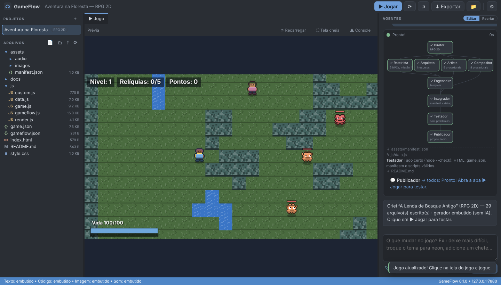
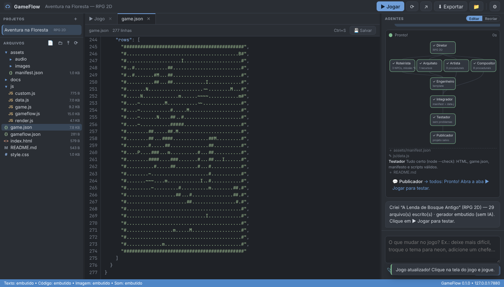
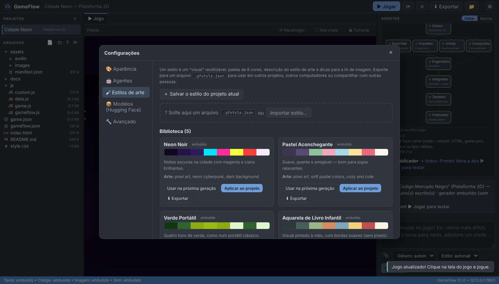
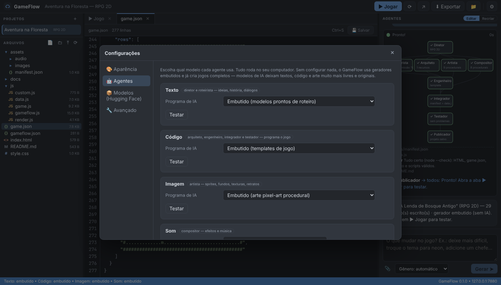

<div align="center">

# 🎮 GameFlow

**Uma IDE estilo VS Code / Cursor, low/no-code, que cria jogos completos a partir de texto — com IAs generativas rodando 100% no seu computador.**

Rust no backend · HTML, CSS e JS na interface e nos jogos gerados · Windows, macOS e Linux

[English](README.md) · **Português (Brasil)**



</div>

---

## O que é

Você descreve o jogo ("um RPG 2D numa floresta mágica com um dragão como chefe final"), opcionalmente anexa desenhos ou sons, e um **fluxo não linear de agentes de IA locais** — Diretor, Roteirista, Arquiteto, Artista, Compositor, Engenheiro, Integrador, Testador e Publicador — constrói o jogo inteiro: código, mapas, história, arte e sons. O resultado é um projeto de **HTML, CSS e JS puros** que roda em qualquer navegador, sem instalar nada.

Feito para **não programadores, artistas independentes e entusiastas**:

- **À direita**: a barra de prompt + o fluxo de agentes trabalhando em tempo real.
- **À esquerda**: projetos e arquivos (código, imagens, sons) — tudo editável.
- **No centro**: o jogo rodando ao vivo, ou o editor de código.

Funciona **sem nenhum modelo de IA configurado** (geradores embutidos já entregam jogos completos e jogáveis) e fica muito mais livre e original quando você liga modelos locais do Hugging Face.

## Instalação (pelo terminal)

**Linux e macOS**

```bash
curl -fsSL https://raw.githubusercontent.com/KMC1525/GameFlow/main/install.sh | sh
```

**Windows (PowerShell)**

```powershell
irm https://raw.githubusercontent.com/KMC1525/GameFlow/main/install.ps1 | iex
```

**A partir do código-fonte** (qualquer sistema com [Rust](https://rustup.rs))

```bash
cargo install --git https://github.com/KMC1525/GameFlow --locked
```

Depois é só rodar:

```bash
gameflow
```

O GameFlow abre a interface no seu navegador (`http://127.0.0.1:7878`).

### Atualização

```bash
gameflow update          # baixa e instala a versão mais recente (com verificação SHA-256)
gameflow update --check  # só verifica se há versão nova
```

### Outros comandos

| Comando | O que faz |
|---|---|
| `gameflow` / `gameflow start [--port N] [--no-open]` | Inicia a IDE |
| `gameflow generate "descrição" [--name X] [--genre G] [--preset P] [--attach arquivo]` | Gera um jogo pelo terminal, sem abrir a interface |
| `gameflow preset list \| import ARQ \| export ID [--out ARQ] \| delete ID` | Gerencia [estilos visuais](#estilos-visuais-presets) |
| `gameflow doctor` | Mostra pastas, runtimes de IA encontrados e agentes configurados |
| `gameflow paths` | Mostra onde ficam projetos, modelos e configurações |

### Variáveis de ambiente (opcionais)

| Variável | Para que serve |
|---|---|
| `GAMEFLOW_HOME` | Guarda **tudo** (projetos, modelos, estilos, configurações) numa pasta só — útil para instalações portáteis |
| `GAMEFLOW_HF_ENDPOINT` | Usa outro endereço no lugar de `https://huggingface.co` (espelhos/proxy) |

## Primeiros passos

1. **＋ Novo projeto** — cada jogo fica salvo num projeto, com todo o código e os assets.
2. **Descreva o jogo** na barra à direita e clique em **Gerar ➤**. Você acompanha cada agente trabalhando.
3. **▶ Jogar** — teste na hora. Peça mudanças em linguagem natural ("deixe mais difícil", "tema neon", "adicione pulo duplo") ou edite os arquivos à esquerda — a prévia recarrega sozinha ao salvar (`Ctrl+S`).
4. **⬇ Exportar** — baixa o jogo como `.zip`. É só abrir o `index.html` em qualquer navegador (ou publicar no itch.io).



### Anexando referências e assets 📎

Arraste ou anexe imagens/sons na barra de prompt. Cada anexo pode ser:

- **referência** — inspiração para a IA; as cores das suas imagens viram a **paleta do jogo**;
- **usar no jogo** — o arquivo entra no jogo como está. O GameFlow casa pelo nome (`heroi.png` → jogador, `chefe.png` → chefe, `musica.wav` → trilha, `fundo.png` → cenário…). Seus arquivos **nunca** são sobrescritos pelos agentes.

Também dá para combinar os dois: texto + anexos.

## Estilos visuais (presets)

Um **estilo** é um "visual" reutilizável: paleta de 8 cores, descrição do estilo de arte e dicas para a IA de imagem. Use para dar a vários jogos a mesma identidade visual, compartilhar um visual com outras pessoas ou guardar seus estilos favoritos.

- **Escolha um** no seletor `Estilo:` da barra de prompt para a próxima geração, ou **aplique a um projeto existente** — paleta, `style.css` e toda a arte gerada são refeitas (seus próprios arquivos não são tocados).
- **Exporte** qualquer estilo para um arquivo portátil `.gfstyle.json`; **importe** arquivos de outras pessoas ou computadores (arraste para Configurações → *Estilos de arte* ou para a barra de prompt).
- **Salve o estilo de um projeto** na sua biblioteca para reutilizar em outros jogos.
- Cinco estilos vêm com o GameFlow: *Neon Noir*, *Pastel Aconchegante*, *Verde Portátil*, *Aquarela de Livro Infantil* e *Crepúsculo de Brasa*.
- Pelo terminal: `gameflow preset export neon-noir`, `gameflow preset import visual.gfstyle.json`, `gameflow generate "…" --preset neon-noir`.

Arquivos importados são validados (formato, versão, tamanho, cores `#rrggbb`) e sempre salvos com um id novo, então nunca sobrescrevem um estilo embutido. O formato está documentado (em inglês) em [`docs/STYLE_PRESETS.md`](docs/STYLE_PRESETS.md).



## Tipos de jogo

| Gênero | Estilo | Destaques |
|---|---|---|
| **RPG 2D** | visão de cima | exploração, NPCs com diálogo, combate em tempo real, XP/nível, relíquias que despertam o chefe |
| **RPG 3D** | câmera 3ª pessoa elevada (Q/E giram) | mesma lógica do RPG 2D em mundo 3D |
| **Visual Novel** | cenas + retratos | roteiro ramificado, escolhas com variáveis e múltiplos finais |
| **Plataforma 2D** | rolagem lateral | fases em texto editáveis, pulo variável, moedas, inimigos, espinhos, pulo duplo opcional |
| **Plataforma 3D** | câmera 3ª pessoa | percurso de plataformas, checkpoints, inimigos patrulhando |
| **FPS (1ª pessoa)** | raycasting | labirintos, munição, vida, mini-mapa |
| **TPS (3ª pessoa)** | arena 3D | ondas de inimigos, tiro, drops de vida |
| **Arcade** | nave | ondas, power-ups, escudo, chefe final |

O gênero é detectado pelo seu texto (ou escolhido no seletor). Os mapas/fases são gerados proceduralmente (determinísticos) e ficam como **texto simples** em `game.json`, então qualquer pessoa pode editá-los à mão.

## Os agentes: um fluxo não linear

```
              ┌─► Roteirista ──┐
   Diretor ───┼─► Arquiteto ───┴─► Engenheiro ─┐
              ├─► Artista ─────────────────────┼─► Integrador ─► Testador ─► Publicador
              └─► Compositor ──────────────────┘       │            │
                       ▲   pedidos de assets faltantes ◄┘            │
                       └──────── retrabalho (Engenheiro #2…) ◄───────┘
```

- Os nós rodam **em paralelo** assim que as dependências terminam e se comunicam por um quadro-negro compartilhado.
- O **Integrador** descobre assets que faltam e **pede ao Artista/Compositor** (novos nós nascem em tempo de execução).
- O **Testador** valida HTML, `game.json`, roteiro, manifesto e a sintaxe de cada script (com `node --check` se o Node.js estiver instalado). Se achar problemas, **devolve ao Engenheiro** com a lista (até N rodadas); persistindo o erro, o código problemático é isolado e restaurado para que o jogo base continue jogável.
- Cada agente usa o modelo da sua **tarefa** (texto, código, imagem ou som) — e **sempre** tem um caminho embutido de reserva, então o pipeline nunca trava por falta de modelo.

| Agente | Tarefa | O que faz |
|---|---|---|
| Diretor | texto | Transforma o pedido (e as cores das referências ou do estilo escolhido) no design do jogo |
| Roteirista | texto | Falas, missão, personagens e roteiros de Visual Novel |
| Arquiteto | código | Escolhe recursos do template e gera mapas/fases |
| Artista | imagem | Sprites, tiles, fundos, texturas e retratos (usa seus arquivos quando marcados) |
| Compositor | som | Efeitos e trilha |
| Engenheiro | código | Instancia o template e escreve mecânicas extras em `js/custom.js` |
| Integrador | código | Manifesto de assets, `index.html`, `js/data.js` |
| Testador | código | Valida e pede correções |
| Publicador | — | README do jogo, metadados do projeto, registro da execução |

Todo trabalho da IA no código acontece por **ganchos seguros** (`GF.on('update', …)` em `js/custom.js`): o jogo base não é reescrito, então um modelo pequeno não consegue "quebrar o jogo inteiro".

## Modelos locais do Hugging Face

Em **⚙ Configurações → Agentes** você escolhe o modelo de cada tarefa; em **Modelos (Hugging Face)** busca e baixa (com retomada e progresso) direto para a pasta local do GameFlow.

| Tarefa | Runtimes suportados |
|---|---|
| Texto / Código | **llama.cpp** (`llama-server` com GGUF baixado do Hub), ou qualquer servidor compatível com a API OpenAI (**Ollama**, **LM Studio**, vLLM…) |
| Imagem | **stable-diffusion.cpp**, servidor compatível (`/images/generations`) ou comando próprio |
| Som | Comando próprio (**Piper** para voz, scripts…) ou o sintetizador embutido |

O GameFlow inicia e gerencia o `llama-server` sozinho. Guia passo a passo em [`docs/MODELOS.md`](docs/MODELOS.md) ([English](docs/MODELS.md)).



### Aparência

Cinzas suaves de baixo brilho com detalhes em **azul dessaturado**, pensados para sessões longas: **Grafite** (padrão), **Névoa**, **Ardósia**, **Crepúsculo** e **Papel** (claro). A **escala da interface** (70–180 %) e o tamanho da letra do editor são ajustáveis; painéis laterais são redimensionáveis.

## Como é um projeto gerado

```
meu-jogo/
├── index.html          # abre direto no navegador (funciona até via file://)
├── style.css           # cores da paleta do jogo
├── game.json           # TUDO editável: história, personagens, cores, mapas, textos
├── js/
│   ├── gameflow.js     # mini-engine (assets, áudio, entrada, telas)
│   ├── engine3d.js     # só nos gêneros 3D (renderizador por software)
│   ├── game.js         # lógica do gênero
│   ├── custom.js       # SEUS ajustes e os da IA (ganchos GF.on)
│   └── data.js         # gerado a partir de game.json + manifesto
├── assets/images/      # PNGs (troque pelo seu desenho mantendo o nome)
├── assets/audio/       # WAVs
├── docs/               # design.md e architecture.md escritos pelos agentes
└── references/         # seus anexos
```

Ganchos de `js/custom.js`:

```js
GF.on('update', (dt) => { /* todo quadro */ });
GF.on('event', (nome, dados) => { if (nome === 'coin') GF.toast('Boa!'); });
```

## Privacidade e segurança

- Tudo roda **localmente**: o servidor escuta só em `127.0.0.1`; nenhum dado seu sai do computador (exceto buscas/downloads no Hugging Face, quando você pede).
- Proteção contra **DNS rebinding** e **CSRF** (valida `Host` e `Origin`), para que sites abertos no seu navegador não consigam chamar a API local.
- Os jogos (potencialmente escritos por IA) rodam num **servidor de origem separada**, dentro de `iframe` com `sandbox`, e com **CSP que bloqueia conexões externas**.
- Estilos importados têm tamanho limitado e validação rigorosa; são só dados e nunca são executados.
- Caminhos de arquivo são validados (sem `..`, sem links simbólicos que escapem do projeto) e a IA só pode escrever em `js/*.js`, `style.css`, `index.html` e `game.json`.

## Desenvolvimento

```bash
git clone https://github.com/KMC1525/GameFlow && cd GameFlow
cargo run                       # abre a IDE (em debug, lê frontend/ e templates/ do disco)
cargo test                      # 50+ testes: geradores, agentes, grafo, projetos, estilos, atualização, segurança
cargo clippy --all-targets -- -D warnings
npm i playwright && npx playwright install chromium
node scripts/smoke-games.js     # gera e "joga" os 8 gêneros no Chromium, falha com qualquer erro de JS
```

```
src/
├── main.rs            CLI (start, update, doctor, generate, preset, paths)
├── server.rs          API REST + SSE, guarda de Host/Origin, servidor de jogos isolado
├── agents/            orquestrador, grafo não linear (graph.rs), papéis (roles.rs), prompts (llm.rs), checagens
├── runtime.rs         llama.cpp gerenciado, OpenAI-compat, stable-diffusion.cpp, comandos
├── hf.rs              busca/arquivos/downloads do Hugging Face
├── presets.rs         estilos visuais: formato, validação, biblioteca, embutidos
├── spec.rs            "contrato" do jogo (game.json), gêneros, temas, heurística de prompt
├── levelgen.rs        mapas e fases procedurais · story.rs roteiros ramificados
├── procedural.rs      arte pixel-art (PNG) e áudio chiptune (WAV) procedurais, paleta por imagem
├── templates.rs       templates embutidos · update.rs auto-atualização
frontend/              interface (HTML/CSS/JS, módulos ES, sem build)
templates/             jogos-base de cada gênero (HTML/CSS/JS)
```

Para publicar uma versão: `git tag v0.2.0 && git push origin v0.2.0` — o workflow `release.yml` compila para Linux (x86_64/arm64), macOS (Intel/Apple Silicon) e Windows, gera `.tar.gz`/`.zip` com `.sha256` e publica; é isso que `install.sh`, `install.ps1` e `gameflow update` consomem. Veja o [changelog](CHANGELOG.md).

## Status e limitações honestas

- Os geradores embutidos, os 8 templates, a interface, o pipeline de agentes (incluindo retrabalho e pedidos de assets) e a segurança têm testes automatizados e foram jogados no Chromium.
- Os caminhos com **modelos reais** (llama.cpp, stable-diffusion.cpp, Piper, Hugging Face) foram validados contra **servidores simulados com a mesma API** (o ambiente de desenvolvimento não tinha GPU nem acesso ao Hub). Se algo se comportar diferente com um modelo real, abra uma issue com a saída de `gameflow doctor`.
- A qualidade do que a IA escreve depende do modelo. Modelos pequenos (≤3B) ajudam mais em texto e pequenos ajustes de código; para mecânicas elaboradas prefira modelos de código de 7B+.
- A arte procedural (sem modelo de imagem) é sempre pixel-art colorida com a paleta do estilo; um estilo que não seja pixel art muda principalmente como o jogo escala os sprites e o que o modelo de imagem é instruído a desenhar.
- Os jogos 3D usam um renderizador por software no Canvas 2D (leve e sem dependências), não WebGL — o visual é propositalmente simples.

## Licença

[MIT](LICENSE)
